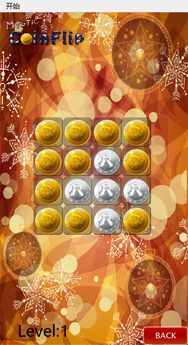

# 快乐翻金币（CoinFlip）

一个用 C++17 和 Qt Widgets 写的桌面益智游戏。棋盘上有 4 × 4 枚硬币，点击一枚会翻转它自己和上下左右相邻的硬币。把整盘翻成金色即可过关。游戏共有 20 个固定关卡，可以按任意顺序挑战。

## 运行

Windows 下已用 Qt 6.9.0 和 MinGW 13.1（64 位）完成 Release 构建。安装对应的 Qt 桌面开发套件（Kit）、MinGW 编译器及 **Qt Multimedia** 模块后，按以下步骤启动游戏。

1. 在 Qt Creator 中打开仓库根目录的 `CoinFlip.pro`。
2. 选择匹配的 MinGW 64 位 Kit，指定一个新的构建目录，例如 `build-local`。
3. 按 `Ctrl+R` 编译并运行。在主菜单点击开始，再选择关卡编号。

在已配置该 Kit 的 Windows 命令提示符中，也可以从仓库根目录直接构建。

```bat
mkdir build-local
cd build-local
qmake ..\CoinFlip.pro -spec win32-g++ "CONFIG+=release"
mingw32-make -j4
release\CoinFlip.exe
```

命令行运行时，当前环境需要能找到同一套 Qt 的 `qmake`、Qt 运行库及 MinGW 的 `mingw32-make`。若 qmake 提示 `Unknown module(s) in QT: multimedia`，请为当前 Qt 版本和编译器补装 Qt Multimedia。

Ubuntu 24.04 下也已使用 Qt 5.15.13 编译并启动。安装依赖后，从仓库根目录执行下列命令，最后一步需要图形桌面。

```sh
sudo apt install build-essential qtbase5-dev qtmultimedia5-dev
mkdir -p build-local
cd build-local
qmake ../CoinFlip.pro
make -j4
./CoinFlip
```

## 试玩第一关



从左上角开始计数，第一关的银币正好组成一个十字。点击**第 3 行、第 3 列**，中心和四枚相邻硬币会依次翻面，随后出现通关提示。右下角的返回按钮可回到选关界面。

## 源码导航

| 文件 | 用途 |
| --- | --- |
| `main.cpp`、`mainscene.cpp`、`mainscene.ui` | 应用入口、主菜单和开始按钮 |
| `chooselevelscene.cpp` | 展示关卡编号，切换到所选棋盘 |
| `dataconfig.cpp` | 20 张 4 × 4 的初始棋盘，1 表示金色，0 表示银色 |
| `playscene.cpp` | 处理点击、翻转相邻硬币、判断通关 |
| `mycoin.cpp`、`mypushbutton.cpp` | 硬币翻面动画和自定义按钮 |
| `res.qrc`、`resource/` | 编译时打包的图片与音效 |
